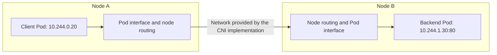
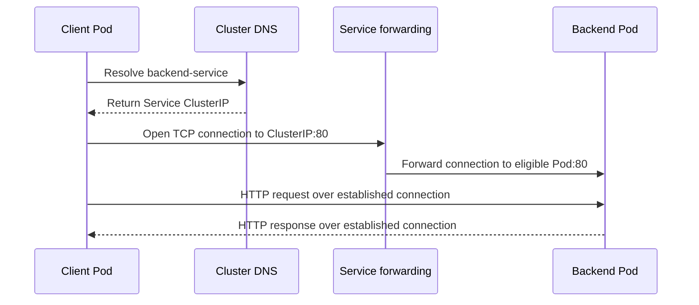
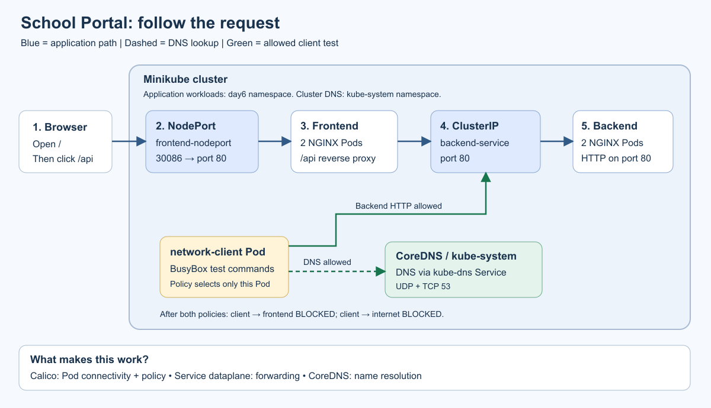
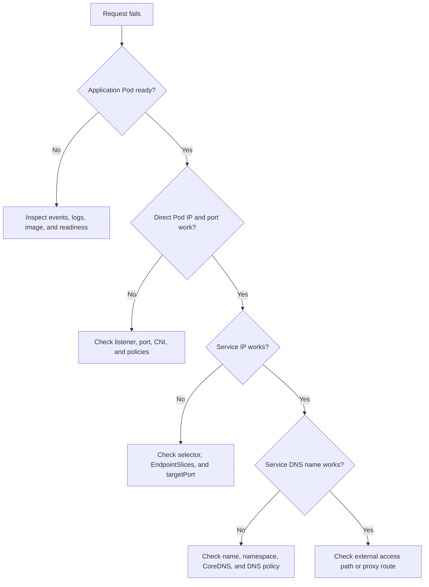

# Day 6 - Kubernetes Networking Deep Dive

Today we will answer one question: **How does a request find the right application in Kubernetes?**

Imagine a student opening a school website. The website runs in a frontend Pod, and its classroom message comes from a backend Pod. Those Pods may move, restart, or run on different machines. Students should still be able to use the same website.

We will understand the journey, build it, observe it, deliberately block one connection, and restore only the connections we need.

## How to use this lesson

Allow about 3 hours, including exercises. You should already know what a Pod, Deployment, namespace, and YAML file are. Commands use **Windows PowerShell**, Docker Desktop with Linux containers, and Minikube. Run them from the repository root, `C:\bari_sagar\Kubernetes`.

| Class segment | Time | Question we will answer |
| --- | --- | --- |
| Addressing and Pod networks | 25 minutes | How do two applications find each other? |
| Services, ports, and DNS | 35 minutes | How do we keep the address stable? |
| CNI and traffic direction | 20 minutes | What makes the network work? |
| School Portal project | 70 minutes | Can we build and prove the request path? |
| Troubleshooting and recap | 30 minutes | How do we find where a request stops? |

Read a concept, make a prediction, run the corresponding experiment, and explain the result in your own words. Commands alone are not the learning goal.

**Lesson map**

- [1. Networking vocabulary](#1-networking-vocabulary)
- [2. Pods and localhost](#2-pods-and-localhost)
- [3. Pod-to-Pod communication](#3-pod-to-pod-communication)
- [4. Services and ports](#4-services-and-ports)
- [5. DNS and the complete request journey](#5-dns-and-the-complete-request-journey)
- [6. CNI and IP ranges](#6-cni-and-ip-ranges)
- [7. Traffic directions and NetworkPolicy](#7-traffic-directions-and-networkpolicy)
- [8. Project: School Portal](#8-project-school-portal)
- [9. Troubleshooting as a detective](#9-troubleshooting-as-a-detective)
- [10. Practice and teacher answer key](#10-practice-and-teacher-answer-key)
- [11. Cleanup](#11-cleanup)

## 1. Networking vocabulary

Think of a school campus. A building has an address, rooms have numbers, and the reception desk helps visitors find the right department.

| Networking term | School analogy | Actual meaning |
| --- | --- | --- |
| Node | School building | A machine running Kubernetes workloads |
| Pod | Classroom | A unit hosting containers with shared networking |
| IP address | Street address | Identifies a network destination |
| Port | Room number | Identifies a listening application on that destination |
| DNS | School directory | Resolves a name to addressing information |
| Service | Department contact | Gives clients a stable way to reach matching Pods |
| CNI networking | Roads between buildings | Configures Pod network connectivity |
| NetworkPolicy | Access rules | Restricts connections to or from selected Pods |

The analogy helps us remember responsibilities. A Service is a Kubernetes API object and networking abstraction; there is no literal reception-desk process handling every packet.

Consider this URL:

```text
http://backend-service:80/
  |          |        | |
protocol   hostname  port path
```

The client must resolve the hostname, connect to an IP and port, and send an HTTP request. Each stage can fail separately.

**Teacher asks:** If you know a building address but enter the wrong room, will you reach the right teacher?

**Answer:** No. Likewise, a correct IP with the wrong port does not reach the intended application. An application must actually be listening at that address and port.

## 2. Pods and localhost

An ordinary Pod has its own network namespace: its view of interfaces, IP addresses, ports, and routing. The containers **inside that Pod share this view**.

```text
Pod: shared-network                    Pod IP: 10.244.0.10
+----------------------------------------------------------------+
| Container: web                 Container: toolbox               |
| NGINX listens on port 80  <---  wget http://127.0.0.1:80          |
|                                                                |
| Shared network namespace, shared localhost, shared port space   |
+----------------------------------------------------------------+
```

`127.0.0.1`, also called `localhost`, means "this network namespace." From the toolbox container above, it reaches the web container because they share a Pod.

From a **different Pod**, `localhost` points back to that different Pod. It will not reach this web container.

Two ordinary servers in the same Pod cannot both bind the same IP, port, and protocol at once. Two servers in different Pods can both listen on TCP port 80 because their Pod IPs differ. Advanced socket-sharing techniques are outside this lesson.

Declaring `containerPort: 80` in YAML documents a port. It does not start a server, open a firewall, or make an application listen. NGINX itself must listen on port 80.

**Try it later:** Project step 10 creates the two-container Pod shown above.

## 3. Pod-to-Pod communication

Suppose a client Pod calls a backend Pod directly:

```text
Client Pod                                    Backend Pod
10.244.0.20  -------- TCP to port 80 -------->  10.244.1.30
```

These addresses are illustrations, not values to copy into your commands.

Kubernetes uses a Pod network model in which ordinary Pods can communicate across nodes without applications needing to manage address translation. NetworkPolicy can restrict that communication. The network implementation determines the actual routing or encapsulation.



For Pods on the same node, traffic can stay within that node's networking. For different nodes, it crosses the node network. Some implementations wrap a packet inside another packet, called an **overlay**; others use routed networking. Both make the Pod address reachable.

Our default Minikube lab has **one node**, so it proves connectivity on that node. The diagram explains the multi-node case; the basic lab does not experimentally demonstrate that case.

### Why not put the backend Pod IP into the frontend code?

```text
Before replacement: backend Pod A = 10.244.1.30
After replacement:  backend Pod B = 10.244.1.44

Frontend configured with 10.244.1.30 ---> old destination
Frontend configured with backend-service ---> current backend endpoints
```

A replacement Pod may receive a different IP. A container restarting within the same existing Pod normally retains the Pod's IP. It is Pod replacement, not every container restart, that makes hardcoded addresses especially fragile.

## 4. Services and ports

A normal ClusterIP Service gives clients a stable virtual IP and DNS name for a set of backends. The address remains stable while that Service exists. Deleting and recreating the Service can allocate a different IP.

Our backend Service uses this selector:

```yaml
selector:
  app: backend
```

Read it aloud: "Find Pods in this Service's namespace whose label `app` equals `backend`."

```text
                            app=backend
                         +----------------> Backend Pod A
                         |
Client -> backend-service
                         |
                         +----------------> Backend Pod B
                            app=backend

Frontend Pod: app=frontend    [does not match; not selected]
```

Names such as `backend-abc123` are not the selection rule; **labels are**.

Kubernetes maintains EndpointSlices containing backend addresses and readiness information. Service forwarding normally sends new connections to eligible, ready endpoints. Readiness probes help prevent a Pod from receiving Service traffic before its application is ready.

Service forwarding is implemented by kube-proxy or an alternative dataplane, such as an eBPF implementation. The virtual Service address is not a Pod. Connections do not necessarily follow a predictable A-B-A-B distribution.

See the official explanations of [Services](https://kubernetes.io/docs/concepts/services-networking/service/) and [EndpointSlices](https://kubernetes.io/docs/concepts/services-networking/endpoint-slices/).

### Understand the three ports

Our frontend Service contains:

```yaml
ports:
  - name: http
    protocol: TCP
    port: 80
    targetPort: http
    nodePort: 30086
```

The frontend container declares a named port:

```yaml
ports:
  - name: http
    containerPort: 80
```

```text
Outside cluster                 Service abstraction          Application
node-address:30086  ---------->  frontend-nodeport:80  ----->  Pod-IP:80
             |                                   |                  |
          nodePort                              port            targetPort
                                                               http -> 80
```

This is a logical mapping, not three separate processes a packet must visit.

| Field | What it means | Our value |
| --- | --- | --- |
| `port` | Port clients use on the Service | `80` |
| `targetPort` | Destination port on selected Pods | Named port `http`, resolving to `80` |
| `nodePort` | Node-level port for external access | `30086` |

For a backend listening on 8080, we could use Service `port: 80` and `targetPort: 8080`. Clients would still call `backend-service:80`. The two numbers do not have to match.

### Compare Service types

| Type | Typical use | Logical request path | Important detail |
| --- | --- | --- | --- |
| ClusterIP | Internal backend | Pod -> Service -> backend Pod | Default; not directly exposed to the internet |
| NodePort | Node-address access | Client -> node port -> backend Pod | Requires a reachable node address |
| LoadBalancer | Externally exposed application | Client -> load balancer -> backend | Requires a supporting implementation |
| ExternalName | DNS alias | DNS lookup -> external hostname | CNAME; no proxy or ClusterIP |

A NodePort Service also has a ClusterIP. The default NodePort range is 30000-32767; administrators can configure another range. LoadBalancer implementations often use NodePorts underneath, although this is implementation-dependent.

On a local cluster, declaring `LoadBalancer` alone does not guarantee an external address. Minikube offers `minikube tunnel`; this project uses NodePort. See [Service types](https://kubernetes.io/docs/concepts/services-networking/service/) and [Minikube access](https://minikube.sigs.k8s.io/docs/handbook/accessing/).

An advanced variation is a **headless Service**, with `clusterIP: None`. Its DNS can return backend Pod addresses instead of a virtual Service IP. We use ordinary ClusterIP Services today.

## 5. DNS and the complete request journey

DNS translates a name into addressing information. Most Kubernetes clusters use CoreDNS for cluster DNS.

```text
backend-service . day6 . svc . cluster.local
       |           |     |          |
   Service     namespace  |     cluster domain
                    Service DNS category
```

`cluster.local` is the lab's default cluster domain; administrators can choose another.

From a Pod in `day6`, `backend-service` works because the Pod's DNS search configuration includes its namespace. From another namespace, use `backend-service.day6` or the full name.

### Trace one request



The last two arrows summarize the established connection, including its return path. DNS helps find an address; it does not carry HTTP responses. The API server stores desired state and helps controllers maintain configuration; it is not in the normal application HTTP path.

Think of looking up a teacher's extension and then making a phone call. The directory helps establish where to call; it does not participate in your conversation.

See [DNS for Services and Pods](https://kubernetes.io/docs/concepts/services-networking/dns-pod-service/) for search paths and Service records.

### ExternalName is a different DNS case

```text
Lookup: external-api.day6.svc.cluster.local
                    |
                    v
             CNAME: example.com
                    |
                    v
      Resolve example.com's external addresses
```

Resolving an alias does not prove an outbound HTTP connection works. Calling HTTP/HTTPS through an alias can also fail if the hostname sent in the request, or checked in a TLS certificate, differs from what the external server expects.

We therefore test the alias with `nslookup`, then test outbound HTTP using the actual external hostname. See [ExternalName Services](https://kubernetes.io/docs/concepts/services-networking/service/#externalname).

## 6. CNI and IP ranges

**CNI means Container Network Interface.** Container runtimes use this interface to invoke networking plugins. A networking implementation sets up Pod interfaces and connectivity, commonly with IP address management and routing components. Policy enforcement depends on the implementation.

Separate these responsibilities:

```text
Pod creation -> runtime invokes CNI -> Pod interface/address/connectivity
Service configuration -> kube-proxy or alternative -> Service forwarding
DNS query -> CoreDNS -> name resolution
NetworkPolicy -> supporting network implementation -> traffic enforcement
```

Some products cover several responsibilities, including replacing kube-proxy.

| Implementation | Useful distinction |
| --- | --- |
| Flannel | Provides Pod networking; Flannel alone does not enforce NetworkPolicy |
| Calico | Provides networking and policy capabilities; used in this lab |
| Cilium | Uses eBPF for networking, security, and observability |

Older tutorials may mention Weave Net. Treat historical product lists separately from an installation decision; this lesson uses the documented [Minikube Calico setup](https://minikube.sigs.k8s.io/docs/handbook/network_policy/).

### Do not mix up address ranges

| Address | Example only | Allocated or managed by | Used for |
| --- | --- | --- | --- |
| Node IP | `192.168.49.2` | Host, VM, cloud, or container network | Reaching the machine |
| Pod IP | `10.244.0.20` | Network/IPAM implementation | Reaching a Pod |
| Service ClusterIP | `10.96.120.10` | Kubernetes control plane | Stable Service destination |
| DNS Service IP | `10.96.0.10` | A Service allocation | Reaching the cluster DNS Service |

CIDR notation describes address ranges. For IPv4, `/24` leaves 8 address bits, giving 256 addresses before reservations or implementation-specific exclusions. `/16` leaves 16 bits, giving 65,536 addresses. You do not need to calculate subnets to complete this lab.

Plan Pod and Service networks to avoid conflicts with each other and reachable host/VPN networks. Actual Calico Pod addresses may differ from every example here.

Inspect actual values after setup:

```powershell
kubectl get nodes -o wide
kubectl get pods -n day6 -o wide
kubectl get svc -n day6 -o wide
kubectl get svc kube-dns -n kube-system
kubectl get nodes -o jsonpath='{.items[*].spec.podCIDR}'
```

The node's `podCIDR` may be empty or may not fully describe the CNI's allocation. It is not a universal source of truth for every plugin.

Optional Minikube-specific inspection:

```powershell
minikube -p day6-networking ssh -- sudo grep service-cluster-ip-range /etc/kubernetes/manifests/kube-apiserver.yaml
minikube -p day6-networking ssh -- sudo grep cluster-cidr /etc/kubernetes/manifests/kube-controller-manager.yaml
```

These files are specific to this setup and are not generally accessible on managed clusters.

## 7. Traffic directions and NetworkPolicy

Direction is relative to the workload:

```text
Frontend Pod  --------------------------->  Backend Pod
              EGRESS from frontend
                                  INGRESS to backend
```

Egress does not mean only internet traffic. Calling another Pod is also egress from the caller.

An **Ingress resource** is a separate Kubernetes concept: HTTP/HTTPS routing configuration interpreted by an Ingress controller.

```text
Browser -> reachable ingress controller -> selected backend
                       ^
                       |
          Ingress rules reference a Service
```

This is a logical route; a controller may forward directly to Service endpoints. An Ingress object needs a controller to implement it. Ingress is not a fifth Service type, and NetworkPolicy is not an HTTP path router. See [Ingress](https://kubernetes.io/docs/concepts/services-networking/ingress/).

### NetworkPolicy as an allow-list

Without applicable isolation policies, the Kubernetes policy model generally allows Pod traffic, subject to the underlying network and other controls.

An egress policy selecting a Pod isolates it for outgoing connections. Its allowed egress becomes the **union of all egress rules in policies selecting it**. An empty list allows no outgoing connections by itself.

Our policies select only:

```yaml
podSelector:
  matchLabels:
    app: network-client
```

The first isolates the client. The second adds DNS and backend allowances. There is no policy ordering or "last rule wins"; a deny-named policy has no special priority.

```text
                     No policies     Empty egress policy     + Allow policy
Client -> DNS           allowed            blocked                allowed
Client -> backend       allowed            blocked                allowed
Client -> frontend      allowed            blocked                blocked
Client -> internet      allowed*           blocked                blocked

* Depends on internet connectivity, firewalls, and the remote server.
```

Only the client Pod is selected. The frontend's `/api` request is a separate connection from the frontend Pod, so this exercise does not block it.

If the destination is ingress-isolated, both source egress and destination ingress rules must allow the connection. Replies to allowed connections are implicitly allowed. Standard NetworkPolicy controls destinations and ports; it does not filter HTTP paths or provide a general hostname-based internet allow-list.

See [Network Policies](https://kubernetes.io/docs/concepts/services-networking/network-policies/) for these semantics and implementation requirements.

## 8. Project: School Portal

**Goal:** open a school webpage, retrieve a classroom message from an internal backend, and prove which connections a test client can make.

The backend is NGINX returning HTML and its Pod name. It is a mock API, so students can focus on networking without writing application code.



[Open the scalable architecture diagram](diagrams/school-portal.svg). Services in this picture are logical forwarding points; responses return over the established connections.

Read the diagram from left to right:

1. The browser reaches the frontend using NodePort.
2. The frontend serves `/` itself.
3. Clicking `/api` asks the **frontend NGINX process** to call `backend-service`.
4. Service forwarding selects one backend Pod.
5. The response returns through the frontend to the browser.
6. A separate `network-client` Pod runs networking experiments.

The browser never needs to resolve `backend-service`. The frontend Pod resolves that internal name. This is a server-side proxy, not browser JavaScript calling a cluster address.

### Files and their purposes

| File | What it teaches |
| --- | --- |
| [00-namespace.yaml](manifests/00-namespace.yaml) | Keeps resources in `day6` |
| [01-frontend-deployment.yaml](manifests/01-frontend-deployment.yaml) | Two frontend Pods; `/api` proxy |
| [02-frontend-nodeport-service.yaml](manifests/02-frontend-nodeport-service.yaml) | External access on NodePort 30086 |
| [03-backend-deployment.yaml](manifests/03-backend-deployment.yaml) | Two backends; response identifies the serving Pod |
| [04-backend-clusterip-service.yaml](manifests/04-backend-clusterip-service.yaml) | Internal `backend-service` |
| [05-externalname-service.yaml](manifests/05-externalname-service.yaml) | Alias to `example.com` |
| [06-network-client-pod.yaml](manifests/06-network-client-pod.yaml) | BusyBox with `wget` and `nslookup` |
| [07-deny-egress-networkpolicy.yaml](manifests/07-deny-egress-networkpolicy.yaml) | Isolates client egress |
| [08-allow-dns-and-backend-egress.yaml](manifests/08-allow-dns-and-backend-egress.yaml) | Allows DNS and backend connections |
| [localhost-pod.yaml](examples/localhost-pod.yaml) | Same-Pod networking experiment |

### Step 1 - Prepare a dedicated cluster

Start Docker Desktop in Linux container mode. Check:

```powershell
docker version
kubectl version --client
minikube version
```

`docker version` must show a working server as well as client. If the engine cannot be reached, start Docker Desktop and wait before continuing.

```powershell
minikube start -p day6-networking --driver=docker --cni=calico
kubectl config use-context day6-networking
kubectl config current-context
kubectl get nodes
kubectl get pods -n kube-system
kubectl rollout status daemonset/calico-node -n kube-system --timeout=300s
kubectl rollout status deployment/coredns -n kube-system --timeout=300s
```

Expected: context `day6-networking`, a Ready node, and healthy Calico/CoreDNS Pods. The first start needs internet access to download images.

A Ready node does not mean Calico has finished initializing. Wait for both rollouts before deploying the application. During initial Calico startup, early application Pods can temporarily report `FailedCreatePodSandBox` with a missing `/var/lib/calico/nodename`; if this persists after Calico should be ready, inspect the Calico Pod events and logs.

This profile separates the cluster from earlier labs. If you already used this exact profile with another CNI, choose a fresh profile name and substitute it consistently. Starting an existing cluster with another `--cni` value is not a reliable migration.

Confirm the DNS labels our policy uses:

```powershell
kubectl get pods -n kube-system -l k8s-app=kube-dns --show-labels
```

If there are no matching DNS Pods, inspect the DNS setup before using the policy. The allowance assumes standard Minikube DNS labels and no NodeLocal DNSCache.

### Step 2 - Create the backend first

```powershell
kubectl apply -f day6/manifests/00-namespace.yaml
kubectl apply -f day6/manifests/03-backend-deployment.yaml
kubectl apply -f day6/manifests/04-backend-clusterip-service.yaml
kubectl rollout status deployment/backend -n day6 --timeout=180s
```

`apply` creates or updates resources. `-f` names the YAML file. `-n day6` targets the namespace. `rollout status` waits for the Deployment.

Expected: two Ready backend Pods. Restore the baseline if repeating the lesson:

```powershell
kubectl delete -f day6/manifests/07-deny-egress-networkpolicy.yaml -f day6/manifests/08-allow-dns-and-backend-egress.yaml --ignore-not-found
```

This removes only the lesson's two policies.

**Understand the backend Deployment**

| YAML field | Explanation |
| --- | --- |
| `replicas: 2` | Maintain two backend Pods |
| `spec.selector.matchLabels` | Identifies Pods managed by this Deployment |
| `template.metadata.labels.app: backend` | Labels each Pod so the Service can find it |
| `image: nginx:1.27` | Runs the exercise's web server |
| `command` and `args` | Write a response file, then start NGINX in the foreground |
| `$HOSTNAME` in the response | Shows which Pod answered |
| `readinessProbe` | Checks `/` on the named HTTP port before Service eligibility |

The HTML is generated inside each container. This is convenient for a networking lesson; a normal application would package content or configuration separately.

### Step 3 - Create the frontend and client

```powershell
kubectl apply -f day6/manifests/01-frontend-deployment.yaml
kubectl apply -f day6/manifests/02-frontend-nodeport-service.yaml
kubectl apply -f day6/manifests/05-externalname-service.yaml
kubectl apply -f day6/manifests/06-network-client-pod.yaml
kubectl rollout status deployment/frontend -n day6 --timeout=180s
kubectl wait --for=condition=Ready pod/network-client -n day6 --timeout=180s
```

We created the backend Service first because frontend NGINX resolves its upstream name when starting.

The key frontend configuration is:

```nginx
location = /api {
  proxy_pass http://backend-service.day6.svc.cluster.local/;
}
```

`location = /api` matches that exact path. `proxy_pass` requests `/` on the backend and returns its response. Thus `/api` works even though the backend only serves an index page.

The client runs a long sleep to remain available during class. `kubectl exec` starts a command inside it. If you previously used the older one-hour client and it is Completed, or `apply` rejects a changed Pod command as immutable, recreate just the client:

```powershell
kubectl delete pod network-client -n day6 --ignore-not-found
kubectl apply -f day6/manifests/06-network-client-pod.yaml
kubectl wait --for=condition=Ready pod/network-client -n day6 --timeout=180s
```

**Do not apply the entire manifests directory at the start.** That applies both policy stages before observing the unrestricted baseline.

### Step 4 - Draw your actual address map

```powershell
kubectl get pods -n day6 -o wide
kubectl get services -n day6
kubectl get pods -n day6 --show-labels
kubectl get endpointslice -n day6 -l kubernetes.io/service-name=backend-service -o wide
```

Record:

```text
Node IP:                    ___________________
network-client Pod IP:      ___________________
Backend Pod A IP:           ___________________
Backend Pod B IP:           ___________________
backend-service ClusterIP:  ___________________
frontend-nodeport mapping:  80:30086/TCP
```

Expected: five application Pods, two backend endpoint addresses, and three Services. ExternalName has no ordinary ClusterIP.

Use EndpointSlices for endpoint inspection. The older `Endpoints` resource appears in previous lessons; EndpointSlices are the current API to learn.

### Step 5 - Test a Pod address, then the Service

Capture a live address:

```powershell
$backendPodIP = kubectl get pods -n day6 -l app=backend -o jsonpath='{.items[0].status.podIP}'
kubectl exec -n day6 network-client -- wget -T 5 -qO- "http://${backendPodIP}:80"
kubectl exec -n day6 network-client -- nslookup backend-service
kubectl exec -n day6 network-client -- wget -T 5 -qO- http://backend-service
```

`--` separates kubectl options from the container command. `wget -T 5` sets a network timeout; `-qO-` prints the response without progress output.

Expected HTTP content, with your Pod name:

```html
<h1>Backend API</h1><p>Hello, networking class!</p><p>Served by Pod: backend-...</p>
```

The first request tests Pod connectivity without Service DNS. `nslookup` tests resolution. The final request combines DNS, Service forwarding, and a listening application.

Also try:

```powershell
kubectl exec -n day6 network-client -- cat /etc/resolv.conf
kubectl exec -n day6 network-client -- nslookup backend-service.day6.svc.cluster.local
kubectl exec -n day6 network-client -- wget -T 5 -qO- http://backend-service.day6.svc.cluster.local
```

Look for the namespace search domain. The DNS server address displayed by `nslookup` is different from the backend Service address in its answer.

### Step 6 - Open the School Portal

In a separate terminal:

```powershell
minikube -p day6-networking service frontend-nodeport -n day6 --url
```

Open the printed URL. On Windows with the Docker driver, keep this command running if it creates a tunnel. You should see **School Portal**. Click **View the backend classroom message** to visit `/api`.

Expected: **Backend API**, **Hello, networking class!**, and a Pod name.

Separately verify the actual NodePort from inside the node:

```powershell
$day6NodeIP = minikube -p day6-networking ip
minikube -p day6-networking ssh -- curl -fsS "http://${day6NodeIP}:30086/api"
```

If laptop access is inconvenient, use:

```powershell
kubectl port-forward -n day6 service/frontend-nodeport 8086:80
```

Keep it running; open `http://127.0.0.1:8086`. From another terminal:

```powershell
Invoke-WebRequest -UseBasicParsing http://127.0.0.1:8086/api | Select-Object -ExpandProperty Content
```

The paths differ:

```text
NodePort:      node:30086 -> Service forwarding -> frontend -> backend
Port-forward: laptop:8086 -> kubectl/API tunnel -> selected frontend Pod -> backend
```

Port-forward proves the application works but does not prove NodePort reachability or the frontend ClusterIP dataplane. Run policy experiments inside `network-client`.

Frontend readiness checks `/`, not backend health. A ready frontend with a broken backend can still fail on `/api`.

### Step 7 - Observe Pod replacement

Record current addresses:

```powershell
kubectl get svc backend-service -n day6
kubectl get pods -n day6 -l app=backend -o wide
```

Delete one lab backend:

```powershell
$backendPodName = kubectl get pods -n day6 -l app=backend -o jsonpath='{.items[0].metadata.name}'
kubectl delete pod $backendPodName -n day6
kubectl rollout status deployment/backend -n day6 --timeout=180s
kubectl get pods -n day6 -l app=backend -o wide
kubectl get svc backend-service -n day6
kubectl get endpointslice -n day6 -l kubernetes.io/service-name=backend-service -o wide
kubectl exec -n day6 network-client -- wget -T 5 -qO- http://backend-service
```

The replacement has a new name and may have a new IP. The Service IP stays the same because that Service was not recreated. EndpointSlices track the replacement once ready.

This shows discovery and recovery, not guaranteed zero interruption: connections to terminating Pods can fail during convergence.

Make several new connections:

```powershell
1..6 | ForEach-Object {
    kubectl exec -n day6 network-client -- wget -T 5 -qO- http://backend-service
}
```

You may see both backend names. Exact alternation or equal counts are not required.

**Teacher asks:** Did we edit the client after replacing a Pod?

**Answer:** No. It still used the same Service name.

### Step 8 - ExternalName and outbound access

```powershell
kubectl describe service external-api -n day6
kubectl exec -n day6 network-client -- nslookup external-api.day6.svc.cluster.local
kubectl exec -n day6 network-client -- wget -T 5 -qO- http://example.com
```

Expected: the alias resolves toward `example.com`; HTTP may return an example webpage if the network permits.

If public HTTP is unavailable because of a proxy, firewall, or remote response, record that baseline failure. Do not later claim NetworkPolicy caused an existing failure. The frontend Service provides a controlled internal destination for the next experiment.

### Step 9 - Block the client, then allow what it needs

#### 9A. Prove both internal destinations work

```powershell
kubectl exec -n day6 network-client -- wget -T 5 -qO- http://backend-service
kubectl exec -n day6 network-client -- wget -T 5 -qO- http://frontend-nodeport
$backendServiceIP = kubectl get svc backend-service -n day6 -o jsonpath='{.spec.clusterIP}'
$frontendServiceIP = kubectl get svc frontend-nodeport -n day6 -o jsonpath='{.spec.clusterIP}'
```

Both requests should return HTML. Save addresses so we can test connectivity independently of DNS.

#### 9B. Apply empty egress rules

```powershell
kubectl apply -f day6/manifests/07-deny-egress-networkpolicy.yaml
kubectl exec -n day6 network-client -- wget -T 5 -qO- "http://${backendServiceIP}"
kubectl exec -n day6 network-client -- wget -T 5 -qO- http://backend-service
```

Expected: both fail, commonly with a timeout or resolution error. Direct-IP failure proves we blocked more than DNS. Policy changes take time to propagate; retry a fresh command if the first races with installation.

The important YAML:

```yaml
policyTypes:
  - Egress
egress: []
```

The selected client is egress-isolated with no allowed destinations from this policy.

#### 9C. Add DNS and backend permissions

```powershell
kubectl apply -f day6/manifests/08-allow-dns-and-backend-egress.yaml
kubectl get networkpolicy -n day6
kubectl exec -n day6 network-client -- nslookup backend-service
kubectl exec -n day6 network-client -- wget -T 5 -qO- http://backend-service
kubectl exec -n day6 network-client -- wget -T 5 -qO- "http://${frontendServiceIP}"
```

Expected: DNS succeeds, backend HTTP succeeds, frontend HTTP fails. Both policies remain installed.

The DNS peer is:

```yaml
to:
  - namespaceSelector:
      matchLabels:
        kubernetes.io/metadata.name: kube-system
    podSelector:
      matchLabels:
        k8s-app: kube-dns
```

Both selectors are in **one list item**, meaning **AND**: DNS-labeled Pods inside `kube-system`. The rule allows UDP and TCP 53 because DNS can use either. Separate list items mean alternative peers and would broaden permission.

The other rule selects `app=backend` Pods on TCP 80. A Pod selector without a namespace selector selects Pods in the policy's own namespace, `day6`. It selects Pods, not the Service object's label.

Optionally repeat external access:

```powershell
kubectl exec -n day6 network-client -- nslookup example.com
kubectl exec -n day6 network-client -- wget -T 5 -qO- http://example.com
```

DNS may resolve the public name, but the client cannot make the subsequent external HTTP connection. Resolving a name does not grant permission to connect.

Open the portal `/api` again: it should still work. The policy selects the test client, not the frontend.

Record your results:

| Test from network-client | Baseline | Deny only | Deny + allow |
| --- | --- | --- | --- |
| Backend by Service IP | Works | Fails | Works |
| Backend by Service name | Works | Fails | Works |
| Frontend by Service IP | Works | Fails | Fails |
| DNS lookup | Works | Blocked | Works |

**Checkpoint:** If the frontend direct-IP request still succeeds, inspect selectors, other policies, and Calico enforcement. A YAML object existing does not prove enforcement.

This Minikube lab uses Pod-based CoreDNS. NodeLocal DNSCache or other Service translation paths may require adapted rules.

### Step 10 - Prove localhost sharing

```powershell
kubectl apply -f day6/examples/localhost-pod.yaml
kubectl wait --for=condition=Ready pod/shared-network -n day6 --timeout=180s
kubectl exec -n day6 shared-network -c toolbox -- wget -T 5 -qO- http://127.0.0.1
```

Expected: NGINX welcome HTML. `-c toolbox` chooses BusyBox, but the server is in the `web` container.

Try localhost from the standalone client:

```powershell
kubectl exec -n day6 network-client -- wget -T 5 -qO- http://127.0.0.1
```

Expected: failure, normally "connection refused," because this Pod has no HTTP server. That explanation is local to the Pod; localhost is not a policy enforcement test.

### Step 11 - Explain what you built

Without the notes, draw:

```text
Browser -> frontend access -> frontend Pod -> backend-service -> backend Pod
Test client -> DNS
Test client -> backend allowed
Test client -> frontend blocked
```

For each arrow, identify source, destination, protocol/port, and whether DNS was needed first. Explain why browser `/api` works while the client's frontend request fails.

## 9. Troubleshooting as a detective

Find the first failed stage before changing anything:



These are clues, not exhaustive diagnoses; different destinations may match different policies.

| Symptom | First useful checks | What to look for |
| --- | --- | --- |
| Pending or ContainerCreating | Describe Pod and inspect events | Scheduling, image, runtime, or CNI errors |
| Frontend CrashLoopBackOff | Frontend logs | Upstream name unresolved; backend Service must exist |
| No ready Service endpoints | Service selector, Pod labels, EndpointSlices | Wrong selector or unready app |
| Pod IP works; Service IP fails | Service ports and forwarding | Incorrect targetPort or Service programming |
| Service IP works; name fails | `nslookup`, CoreDNS, DNS permissions | Wrong name/namespace or blocked DNS |
| Connection refused | Logs and listening port | No expected listener or active rejection |
| Timeout | Policies, routes, endpoints | Dropped packets or missing return path |
| Portal `/` works; `/api` fails | Frontend logs and backend Service | Upstream connectivity or backend failure |
| NodePort works inside node only | Minikube URL and host routing | Windows Docker-driver reachability |
| Denied client still reaches all destinations | Pod selector and Calico | Wrong labels, broad allows, no enforcement |

Useful commands:

```powershell
kubectl get pods -n day6 -o wide
kubectl describe service backend-service -n day6
kubectl get pods -n day6 -l app=backend --show-labels
kubectl get endpointslice -n day6 -l kubernetes.io/service-name=backend-service -o yaml
kubectl logs -n day6 deploy/frontend --tail=30
kubectl logs -n day6 deploy/backend --tail=30
kubectl get events -n day6 --sort-by=.metadata.creationTimestamp
kubectl get pods -n kube-system
kubectl logs -n kube-system -l k8s-app=kube-dns --tail=30
kubectl get networkpolicy -n day6 -o yaml
```

Use `kubectl describe pod -n day6 <pod-name>` for one Pod, replacing the placeholder with its actual name.

DNS logs may not list individual queries unless query logging is enabled. Also, `ping` is not a sufficient Service test: ICMP echo does not test the Service's HTTP forwarding.

## 10. Practice and teacher answer key

### Exercise A - Predict a port mismatch

A server listens on 8080. Its Service has `port: 80` and `targetPort: 80`. DNS works but HTTP fails. What needs attention?

**Answer:** Set `targetPort` to 8080, or a named port resolving to 8080. Keep `port: 80` if clients should continue using 80.

### Exercise B - Break and repair a selector

Run only in the lesson namespace:

```powershell
kubectl set selector service/backend-service app=does-not-exist -n day6
kubectl get endpointslice -n day6 -l kubernetes.io/service-name=backend-service -o yaml
kubectl exec -n day6 network-client -- wget -T 5 -qO- http://backend-service
```

**Prediction:** DNS resolves because the Service exists, but the selector finds no backend Pods. After endpoint reconciliation, HTTP fails.

Repair:

```powershell
kubectl apply -f day6/manifests/04-backend-clusterip-service.yaml
kubectl get endpointslice -n day6 -l kubernetes.io/service-name=backend-service -o wide
kubectl exec -n day6 network-client -- wget -T 5 -qO- http://backend-service
```

Allow time for reconciliation, then verify success. This separates name resolution from endpoint discovery.

### Exercise C - Add backend capacity

```powershell
kubectl scale deployment/backend -n day6 --replicas=3
kubectl rollout status deployment/backend -n day6 --timeout=180s
kubectl get endpointslice -n day6 -l kubernetes.io/service-name=backend-service -o wide
```

**Answer:** A third eligible backend address appears after readiness; the client name stays the same. Restore:

```powershell
kubectl scale deployment/backend -n day6 --replicas=2
kubectl rollout status deployment/backend -n day6 --timeout=180s
```

### Quick oral assessment

| Teacher question | Expected student explanation |
| --- | --- |
| Why does localhost work across containers in one Pod? | They share a network namespace |
| Why use a Service instead of a Pod IP? | Stable discovery despite backend replacement |
| Does CoreDNS balance every HTTP request? | No; DNS resolves, then the dataplane handles connections |
| Does a Service select Deployment names? | No; it matches Pod labels in its namespace |
| Is a ClusterIP a Pod IP? | No; it is a virtual Service address |
| Does NetworkPolicy need an enforcing implementation? | Yes; the object alone is insufficient |
| Does the allow policy replace the deny-named policy? | No; applicable allowances are combined |
| Why allow UDP and TCP 53? | DNS can use both |
| Why can the browser still use `/api`? | The unselected frontend Pod calls the backend |
| What did the one-node lab not prove? | Cross-node connectivity needs Pods on different nodes |

**Completion checklist**

- [ ] Explain IP, port, DNS, Pod, Service, and CNI in your own words.
- [ ] Draw the browser-to-backend path.
- [ ] Show actual Pod, Service, node, and DNS addresses.
- [ ] Retrieve backend content by Pod IP and Service DNS.
- [ ] Replace a backend without changing the client name.
- [ ] Observe denied egress, then permitted DNS/backend with frontend blocked.
- [ ] Demonstrate two-container localhost communication.
- [ ] Break and repair a Service selector.

## 11. Cleanup

Stop port-forward or Minikube service tunnels with **Ctrl+C**.

Delete the lesson namespace in its explicit context:

```powershell
kubectl --context day6-networking delete namespace day6 --ignore-not-found
minikube stop -p day6-networking
```

This removes all lesson Pods, Services, and policies, including the localhost example. Stopping the profile retains cluster data for another session.

To remove the dedicated lesson cluster completely:

```powershell
minikube delete -p day6-networking
```

Before returning to another day, explicitly select that cluster's context, for example `kubectl config use-context minikube` if that is your earlier lab.

## Further reading

- [Kubernetes cluster networking](https://kubernetes.io/docs/concepts/cluster-administration/networking/)
- [Services](https://kubernetes.io/docs/concepts/services-networking/service/)
- [EndpointSlices](https://kubernetes.io/docs/concepts/services-networking/endpoint-slices/)
- [Service and Pod DNS](https://kubernetes.io/docs/concepts/services-networking/dns-pod-service/)
- [NetworkPolicy](https://kubernetes.io/docs/concepts/services-networking/network-policies/)
- [Ingress](https://kubernetes.io/docs/concepts/services-networking/ingress/)
- [Minikube with Calico](https://minikube.sigs.k8s.io/docs/handbook/network_policy/)
- [Accessing Minikube applications](https://minikube.sigs.k8s.io/docs/handbook/accessing/)
