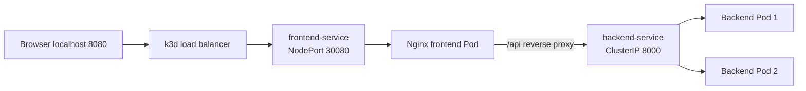

# What We Learned: Kubernetes Networking and Scheduling

This file is a concept reference for the Mini Shop lab. It explains what each Kubernetes object did, how traffic moved through the cluster, how the scheduler placed Pods, and how Kubernetes recovered from failures.

## 1. The complete application

The project contains a static Nginx frontend and a small Python backend API.



The browser knows only `http://localhost:8080`. It does not resolve Kubernetes DNS names. Nginx runs inside the cluster, so Nginx can resolve `backend-service.mini-shop.svc.cluster.local` and send the API request to the backend Service.

## 2. Cluster architecture

The lab uses one control-plane node and two worker nodes.

The control plane contains the components that manage the cluster:

- **API Server** accepts `kubectl` commands and validates Kubernetes objects.
- **Scheduler** chooses a worker node for a new Pod.
- **Controller Manager** compares desired state with actual state and repairs differences.
- **Cluster datastore** stores Deployments, Services, Pods, labels, and configuration.

Worker nodes run the application:

- **Kubelet** starts Pods and reports their health.
- **Container runtime** runs the frontend and backend containers.
- **Network components** provide Pod-to-Pod and Service networking.

The control plane is the decision maker. Worker nodes are where the containers run.

## 3. Docker, k3d, and Kubernetes

Docker Desktop provides the local container runtime. k3d creates a lightweight k3s cluster inside Docker containers:

```text
Docker Desktop
  ├── k3d server container
  ├── k3d worker container 1
  └── k3d worker container 2
```

The images are built locally and imported into k3d:

```powershell
docker build -t mini-shop-backend:local ./app/backend
docker build -t mini-shop-frontend:local ./app/frontend
k3d image import mini-shop-backend:local -c mini-shop
k3d image import mini-shop-frontend:local -c mini-shop
```

The important flow is:

```text
Docker builds the image -> k3d imports the image -> Kubernetes runs the image
```

No public registry is required for this lab.

## 4. Namespace isolation

All project objects are placed in the `mini-shop` namespace.

```powershell
kubectl get all -n mini-shop
```

A namespace gives the project a clear boundary. It makes inspection easier and lets us clean up the lab without touching other experiments:

```powershell
kubectl delete namespace mini-shop
```

Using a dedicated namespace is safer than putting teaching resources in `default`.

## 5. Pods, Deployments, and ReplicaSets

A Pod is the smallest Kubernetes execution unit. The frontend Pod contains Nginx, and each backend Pod contains the Python API.

We create Deployments instead of creating Pods manually:

```text
Deployment -> ReplicaSet -> Pods
```

The backend Deployment requests two replicas. The ReplicaSet makes sure two matching Pods exist. If one is deleted, the controller creates a replacement.

The Deployment describes desired state. Kubernetes continuously works to make the actual cluster match that desired state.

## 6. Labels and selectors

Labels describe objects:

```yaml
app.kubernetes.io/name: backend
```

Selectors find objects with matching labels. The backend Service selects backend Pods using the same label.

```text
Service selector
      ↓
Matching Pod labels
      ↓
EndpointSlice addresses
      ↓
Backend Pods
```

If the Service selector and Pod labels do not match, the Service has no endpoints and requests fail.

## 7. Services and stable networking

Pod IP addresses are temporary. A Pod receives a new IP when it is recreated. A Service provides a stable name and virtual IP.

### Backend ClusterIP

The backend Service is internal:

```text
backend-service:8000
```

Its ClusterIP is reachable from Pods inside the cluster. It is not directly exposed to the Windows host.

### Frontend NodePort

The frontend Service uses NodePort `30080`. k3d maps host port `8080` to that NodePort:

```text
localhost:8080 -> k3d load balancer -> NodePort 30080 -> frontend Pod:80
```

The NodePort is the teaching-friendly entry point from Windows.

## 8. Kubernetes DNS and CoreDNS

CoreDNS gives Kubernetes Services internal DNS names. From a diagnostic Pod, this works:

```powershell
kubectl exec -n mini-shop api-check -- nslookup backend-service
kubectl exec -n mini-shop api-check -- wget -qO- http://backend-service:8000/api/products
```

The browser cannot resolve `backend-service` because the browser runs outside the cluster. That is why the browser calls the same-origin path `/api/products`, and Nginx performs the internal lookup.

## 9. Nginx reverse proxy

The frontend JavaScript uses:

```javascript
fetch('/api/products')
```

Nginx forwards `/api/` to the backend Service:

```nginx
location /api/ {
    proxy_pass http://backend-service.mini-shop.svc.cluster.local:8000/api/;
}
```

This design keeps the browser simple. The browser sees one application origin and never needs to know the backend Pod IP, ClusterIP, worker node, or Kubernetes DNS suffix.

## 10. Node affinity

Node affinity controls which nodes may run an application Pod. Both worker nodes have this label:

```text
lab-role=app
```

The Deployments require that label:

```yaml
requiredDuringSchedulingIgnoredDuringExecution:
  nodeSelectorTerms:
    - matchExpressions:
        - key: lab-role
          operator: In
          values: [app]
```

The word `required` means the rule must be satisfied. If no node has the label, the Pod remains `Pending` and the scheduler reports an affinity failure.

## 11. Pod anti-affinity

Backend replicas use required Pod anti-affinity with the topology key `kubernetes.io/hostname`:

```yaml
podAntiAffinity:
  requiredDuringSchedulingIgnoredDuringExecution:
    - labelSelector:
        matchLabels:
          app.kubernetes.io/name: backend
      topologyKey: kubernetes.io/hostname
```

This says that two backend Pods cannot use the same worker hostname.

The normal layout is:

```text
Worker 1: Backend Pod 1
Worker 2: Backend Pod 2
```

This improves availability because one worker can fail while the other backend replica remains on a different worker.

If we scale to three replicas while only two worker hostnames are eligible, the third Pod has nowhere valid to go:

```text
Worker 1: Backend Pod 1
Worker 2: Backend Pod 2
Third Pod: Pending
```

That Pending state is expected. The Deployment created the desired Pod, but the scheduler could not satisfy the strict anti-affinity rule.

## 12. Pod affinity

The frontend uses required Pod affinity to backend Pods:

```yaml
podAffinity:
  requiredDuringSchedulingIgnoredDuringExecution:
    - labelSelector:
        matchLabels:
          app.kubernetes.io/name: backend
      topologyKey: kubernetes.io/hostname
```

This says that the frontend must run on a hostname that already contains a backend Pod.

Valid placement:

```text
Worker 1: Backend Pod + Frontend Pod
Worker 2: Backend Pod
```

If the frontend is created before any backend Pod exists, it remains Pending. After the backend Deployment creates Ready Pods, the scheduler can place the frontend.

The three placement concepts are:

| Rule | Question it answers |
|---|---|
| Node affinity | Which nodes are allowed? |
| Pod affinity | Which other Pods must be nearby? |
| Pod anti-affinity | Which other Pods must be separated? |

## 13. Readiness and liveness probes

The backend provides `/healthz` and `/readyz`. The frontend provides `/`.

### Liveness

The liveness probe asks whether the container is still alive. Repeated failure causes Kubernetes to restart the container.

### Readiness

The readiness probe asks whether the Pod is ready for traffic. A not-ready Pod is removed from Service endpoints until it recovers.

```text
Liveness failure  -> restart container
Readiness failure -> stop sending Service traffic
```

Readiness prevents requests from reaching an application that is still starting or is temporarily unhealthy.

## 14. Resource requests and limits

The containers use small resource values because this is a laptop lab:

```yaml
resources:
  requests:
    cpu: 25m
    memory: 32Mi
  limits:
    cpu: 100m
    memory: 96Mi
```

Requests tell the scheduler how much capacity to reserve. Limits cap the container's maximum usage.

If requests are too large for the workers, a Pod can remain Pending even when affinity rules are correct.

## 15. NetworkPolicy

The project includes a policy allowing frontend Pods to reach backend Pods on TCP port 8000.

```text
Frontend Pod --allowed TCP 8000--> Backend Pod
```

NetworkPolicy is another traffic-control layer. It uses labels, namespaces, ports, and protocols to describe which traffic is allowed. The policy reinforces the intended flow: the frontend calls the backend, while the browser does not connect directly to the backend.

## 16. EndpointSlices

The backend Service uses EndpointSlices to track ready backend addresses:

```text
backend-service
  ├── 10.42.1.7:8000
  └── 10.42.2.7:8000
```

When a backend Pod is deleted, its endpoint is removed. When the replacement becomes Ready, its new IP is added. The Service name remains stable even though the Pod name and IP change.

Inspect this relationship with:

```powershell
kubectl get svc,endpointslice -n mini-shop
```

## 17. Scaling and the scheduler

Scaling changes the Deployment's desired replica count:

```powershell
kubectl scale deployment/backend -n mini-shop --replicas=3
```

Two controllers have different responsibilities:

```text
Deployment controller -> creates the missing third Pod
Scheduler              -> searches for a valid worker
```

The Pod can exist while remaining Pending. A Pending Pod means Kubernetes accepted the desired object but has not found a valid placement.

## 18. Self-healing

When a backend Pod is deleted:

```powershell
kubectl delete pod <pod-name> -n mini-shop
```

Kubernetes detects that the actual replica count is below the desired count and creates a replacement. The replacement has a different name and usually a different IP, but the Service continues to work because it selects the stable backend label.

```text
Pod identity is temporary.
Service identity is stable.
```

## 19. Troubleshooting method

Start with the current state:

```powershell
kubectl get pods -n mini-shop -o wide
```

Then inspect scheduling and lifecycle events:

```powershell
kubectl describe pod <pod-name> -n mini-shop
```

Check application logs:

```powershell
kubectl logs -n mini-shop deploy/backend
kubectl logs -n mini-shop deploy/frontend
```

Check Service selectors and endpoints:

```powershell
kubectl get svc -n mini-shop
kubectl get endpointslice -n mini-shop
```

Check internal DNS and API traffic:

```powershell
kubectl exec -n mini-shop api-check -- nslookup backend-service
kubectl exec -n mini-shop api-check -- wget -qO- http://backend-service:8000/api/products
```

Check the Windows entry point:

```powershell
Invoke-WebRequest -UseBasicParsing http://localhost:8080/api/products
```

Common causes include missing node labels, unsatisfied affinity, anti-affinity conflicts, incorrect Service selectors, failed readiness probes, unavailable images, and insufficient worker resources.

## 20. What each lab taught

| Lab | Main lesson |
|---|---|
| 1 | Control plane, workers, node labels, and cluster inspection |
| 2 | Local image building and k3d image import |
| 3 | Namespace, Deployments, Pods, Services, and probes |
| 4 | NodePort and localhost access |
| 5 | CoreDNS, ClusterIP, and internal Service communication |
| 6 | Node affinity and Pod affinity |
| 7 | Pod anti-affinity and replica separation |
| 8 | Scaling limits and Pending Pods |
| 9 | Deployment self-healing and EndpointSlice updates |
| 10 | Safe cleanup using namespace and cluster boundaries |

## Final request and scheduling flows

The request path is:

```text
Browser localhost:8080
  -> k3d load balancer
  -> frontend NodePort Service
  -> Nginx frontend Pod
  -> /api reverse proxy
  -> backend ClusterIP Service
  -> EndpointSlice
  -> Ready backend Pod
```

The scheduling decision is:

```text
Does the node have lab-role=app?
  -> Does node affinity pass?
  -> Does backend anti-affinity allow this hostname?
  -> Does frontend affinity find a backend Pod?
  -> Are resource requests available?
  -> Schedule the Pod
```

The central Kubernetes lesson is that controllers continuously work together: Deployments maintain replicas, the scheduler chooses valid nodes, Services provide stable networking, DNS provides internal names, probes control traffic, affinity controls placement, anti-affinity improves separation, and controllers repair failures.
