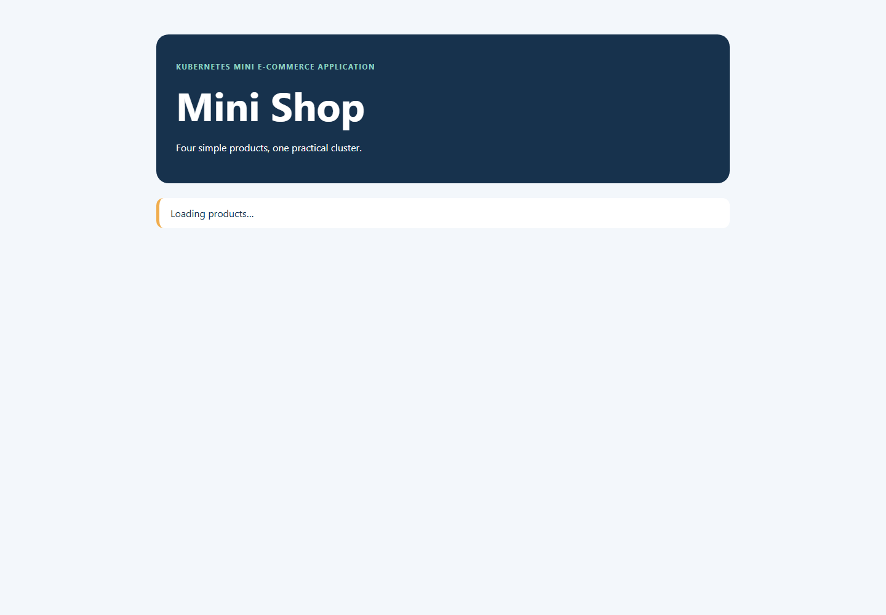
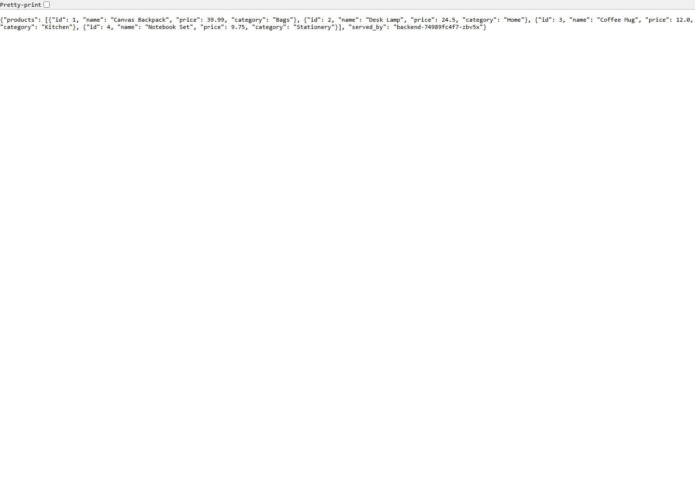

# GitHub screenshot and evidence checklist

These PNGs were captured from the running local NodePort after the live endpoint checks passed:

The text evidence files are copied from the successful k3d verification runs:

- `03-cluster-nodes.txt` — one control-plane node and two labeled app workers.
- `04-pod-placement.txt` — backend replicas separated across workers and frontend placement.
- `05-services-and-endpoints.txt` — ClusterIP, NodePort, and backend endpoints.
- `06-affinity-gate.txt` — frontend Pending prerequisite demonstration.
- `07-anti-affinity-scale.txt` — third backend replica Pending with two eligible workers.

For a student rerun, capture these additional views:

1. `kubectl get nodes --show-labels` showing one server and two `lab-role=app` workers.
2. `kubectl get pods -n mini-shop -o wide` showing backend replicas and frontend node placement.
3. Browser at `http://localhost:8080` showing the four products.
4. `kubectl get svc -n mini-shop` showing `frontend-service` NodePort `30080` and backend ClusterIP `8000`.
5. Frontend Pending before backend deployment, followed by `kubectl describe pod` showing the affinity scheduling reason.
6. Backend scaled to three replicas with the third Pod Pending because two worker hostnames are available.
7. `kubectl get endpointslice -n mini-shop` showing backend endpoints.

Do not capture credentials, private registry tokens, or unrelated local applications.
